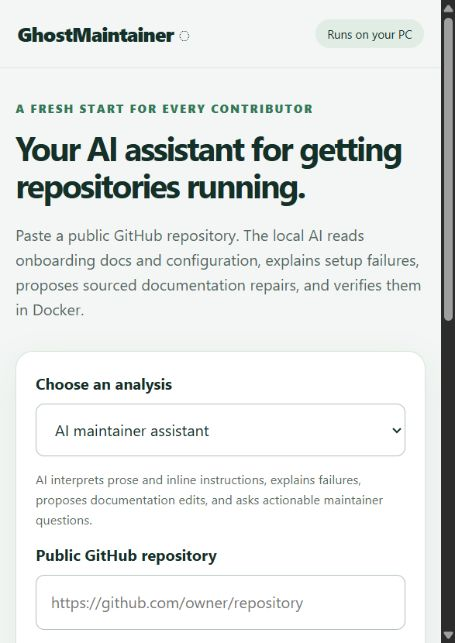

# GhostMaintainer

**GhostMaintainer checks whether a new contributor can follow a repository's setup on a clean machine, then proposes and verifies a documentation repair.**

[](https://github.com/raghavg1024-stack/GhostMaintaine/actions/workflows/check.yml)
[MIT license](LICENSE) · [User guide](docs/USER_GUIDE.md) · [Architecture](docs/ARCHITECTURE.md) · [API](docs/API.md) · [Evidence](docs/EVIDENCE.md) · [Roadmap](docs/ROADMAP.md)

**[Open the website](https://ghostmaintainer.vercel.app/)** · [Recorded execution evidence](https://ghostmaintainer.vercel.app/evidence/)

The website hosts the interface. Start the local app on your PC to run repository checks with Docker and your selected Ollama model.

Paste a public GitHub repository URL into the local website. GhostMaintainer reads a small, selected set of onboarding evidence, runs its instructions in a clean Docker environment, explains failures, and verifies documentation repairs against the same test target.

GitHub Issues collect problems someone has reported. GhostMaintainer checks whether setup instructions work before a contributor has to discover and report a failure. Its useful output is a recorded setup attempt, the exact failed command, a sourced documentation diff when possible, and fresh execution of the same fixed test. Maintainers can repeat this check after setup instructions or dependencies change; contributors can share the evidence instead of reconstructing their terminal history.

For example, if a documented test fails because initialization was skipped, GhostMaintainer looks for the initialization command in repository evidence, proposes adding that instruction, and verifies the patched path in a fresh container. If Git is missing from the container or credentials are required, it reports the blocker. Neither case establishes an upstream documentation defect.

**Status: hackathon prototype.** A live AI fixture repair has passed; reliable repair on unfamiliar real repositories remains unverified. Model explanations can be wrong. The frontend is deployed on Vercel; repository analysis runs locally. Setup success is not guaranteed.

[](https://ghostmaintainer.vercel.app/)

Current deployed interface, captured on October 31, 2026.

## Start the website

Install **Python 3.11+**, **Git**, and **Docker** with Linux containers. Install Ollama for local AI mode. Local inference needs no paid API key.

```sh
git clone https://github.com/raghavg1024-stack/GhostMaintaine.git
cd GhostMaintaine
docker pull python:3.12-slim
ollama list
python app.py
```

Open **http://127.0.0.1:8765**. On Windows, `./start.ps1` is an alternative launcher. Use the source checkout; the full web/fixture assets are not packaged as a standalone pip application.

Assistant mode defaults to the tested installed tag `qwen3:4b-instruct`. Install an instruction model through Ollama if needed and select its exact installed name in **Check settings**. Model weights are not included; availability and license depend on the model you install.

### Choose a resource mode

| Mode | Default model | Prompt budget | What to expect |
|---|---|---:|---|
| Low memory | `qwen3:1.7b` | 4,096 context tokens; 6,000 selected characters | Smaller model and shorter evidence pack; reasoning quality and speed vary by PC |
| Balanced | `qwen3:4b-instruct` | 8,192 context tokens; 16,000 selected characters | Default assistant mode |
| Rules only | None | No model prompt | Deterministic checks only; cannot interpret setup prose |

Ollama lists the [Qwen3 1.7B and 4B quantized model files](https://ollama.com/library/qwen3) at about 1.4 GB and 2.5 GB respectively. These are weight sizes, not total memory requirements; Docker, model runtime, and context need additional memory. The app sends selected setup documents and a small number of relevant files, not the whole repository.

Large documents are searched in 12-line blocks across the file, including setup sections below line 180. Setup terms rank the initial excerpts; actual failure terms guide repair excerpts. The budget is shared between the README and other evidence, so a long README cannot consume all configuration space. Original source line numbers are preserved, and citations to omitted lines are rejected. The initial planning call also uses this bounded selection; full documents stay local for applying exact edits. `report.json` records selected original lines and character counts per repair attempt.

This is keyword-based evidence selection, not complete repository understanding. It may miss an important instruction; file inputs above 2 MB are skipped. Character budgets limit selected text, not exact tokenizer usage. A smaller model can still reason incorrectly, and Docker or repository dependencies may exceed a low-end PC's resources. Use rules-only mode without model inference, or optional remote inference if model memory is the bottleneck; execution remains local in both cases.

### Optional remote Ollama

Local inference is the default. To use an Ollama server over HTTPS instead, set `GHOST_OLLAMA_URL` before starting GhostMaintainer; optionally set `GHOST_OLLAMA_API_KEY` for that server:

```powershell
$env:GHOST_OLLAMA_URL = 'https://ollama.example:11434'
$env:GHOST_OLLAMA_API_KEY = 'your-server-key' # optional
python app.py
```

The form asks for explicit consent before checking or sending selected setup documents, configuration excerpts, and trimmed failure logs to the remote server. The whole repository is not sent. This moves model inference only: cloning and Docker verification still run on this PC.

Remote mode is not preconfigured, and a rules-only check makes no model call. Inspect the repository before running it; log redaction cannot guarantee that every secret is removed.

1. Choose **AI maintainer assistant**.
2. Paste an inspected public GitHub root URL.
3. In **Check settings**, choose a resource mode and intended test command; optionally enable dependency-download networking.
4. Click **Ask GhostMaintainer** and read the explanation, evidence, questions and result.
5. Review the exact verified documentation diff before applying it yourself. The web app never opens PRs or writes upstream.

The default goal is `python -m unittest discover -v` unless the repository supplies `ghostmaintainer.json`. Change it for projects using another runner. Zero tests is not a pass. Supported execution is currently Python/Linux with a root README.md; missing tools, complex setup and unsupported repositories may remain blocked.

## What the AI does

| Step | AI responsibility | Deterministic control |
|---|---|---|
| Understand | Interpret README/CONTRIBUTING prose, inline code and a contributor path | Validate selected commands and citations |
| Diagnose | Explain logs using configuration and selected source/tests | Preserve actual logs and the unchanged test target |
| Propose | Write documentation prose/commands and maintainer questions | Constrain edit paths; validate unique context and source locations |
| Verify | Independently interpret patched documents without the repair context | Run in fresh Docker; require successful non-empty verification |

Up to three repair attempts are allowed. Original instructions are repeated as a negative control. A model's confidence and file citations do not prove its explanation is correct. Proposed changes are offered as verified only when the execution check passes.

## Website modes and features

| Capability | Available behavior |
|---|---|
| AI assistant | Interpretation, failure explanation, documentation proposals and maintainer questions; low-memory and balanced context profiles |
| Rules-only setup check | Deterministic check with no Ollama or model; cannot interpret prose |
| Rules-based drill | Legacy bounded search over config commands |
| Setup artifacts | Generates setup.sh, devcontainer.json and agent instructions; setup.sh alone is separately verified |
| Drift audit | Advisory literal Python/Node environment-variable and version checks |
| Python matrix | Runs multiple Python images; grid and CI-sourced version note |
| Friction/replay | Recorded command timings, failure details and interactive saved-event scrubber |
| GhostBench v0 | Small hand-labelled model-selection comparison and fixture recovery checks |
| Repository scan | Safety/license prefilters and anonymous local aggregate results |
| PR Guard | Rules-only controlled-fixture GitHub Action, artifacts and same-repo patch comments |

There is no sample button in the website. Bundled fixtures are retained for transparent tests and demonstrations. See the [user guide](docs/USER_GUIDE.md) for every mode, settings, artifacts, limits and troubleshooting.

## Reproduce a controlled check

```sh
# No model required; actual Docker verification.
python ghostmaintainer.py drill fixtures/haunted_init --backend docker

# AI reasoning and generated documentation repair.
python ghostmaintainer.py assist fixtures/haunted_env --labeller qwen3:4b-instruct

# Restricted fixture-only checks; not a host runner for arbitrary repos.
python ghostmaintainer.py eval --backend fixture
```

For another repository, fix the test target before repair:

```json
{"cmd": "python -m unittest discover -v"}
```

Save that as `ghostmaintainer.json` at its root, or provide the command through the website. CLI `--net` explicitly permits container networking. See [development](docs/DEVELOPMENT.md) for matrix, ship, benchmark, scan and test commands.

## Verified evidence and limits

Latest upgraded run: the synthetic `haunted_env` repair completed in **98.46 seconds**, with all three recorded Qwen calls uncached. Two selected real repositories passed with preparation enabled; a blind Humanize case was inconclusive. [All case records](docs/REAL_REPO_RESULTS.md).

- Current local run: **51 tests discovered; 44 passed and 7 Docker-only tests skipped**. The latest recorded full Docker run before the resource-profile changes had 38 tests pass; Docker integration has not been rerun for this change. Assistant tests use mocked model responses and do not establish model accuracy.
- An earlier schema-constrained AI `haunted_env` repair passed in **16.697 seconds** with **three uncached Qwen calls** and fresh original/control/verification runs.
- A multi-gap fixture repair and a missing-token question were also recorded. Their runtimes/context settings differ.
- Python matrix: 3.9 fails the version-sensitive fixture; 3.11 and 3.12 pass.
- Both example setup scripts passed separate fresh-container verification.
- Legacy GhostBench v0: rules 6/9, Qwen 8/9 labelled selections; both recovered 2/2 failure-inducing fixture mutations. Cache-sensitive latency is disclosed. This does not measure the new reasoning assistant.
- Real-repository attempts exposed missing tools, src-layout misdiagnoses and invalid AI patches. No successful independent real-repository repair is claimed.

Selected recorded artifacts are committed under [docs/evidence](docs/evidence/). Full local runs, caches and external repository clones are excluded. Read [evidence details](docs/EVIDENCE.md) before interpreting the numbers.

## Security and hosting

The server binds to loopback, validates Host/Origin and requires a session token for POST requests. Docker runs non-root with resource limits, dropped capabilities, disposable workspaces and network off by default. These controls are not complete protection against malicious repositories.

**Run inspected inputs only. Do not expose this prototype as a public multi-tenant service.** Models can hallucinate; repositories can contain secrets; tests/markers can be forged. See [SECURITY.md](SECURITY.md).

## Project map

```text
app.py                  Local HTTP API and job execution
assistant.py            Model-led interpretation and repair
ghostmaintainer.py       Runner, verification, legacy CLI and reports
features.py             Audits, matrix, ship, bench, scan and guard
web/index.html          Browser interface
fixtures/               Deliberately controlled evaluation inputs
bench/                  Hand labels, pinned sources and selection list
examples/               Drift audit example
test_*.py               Regression tests
.github/workflows/      CI and controlled PR Guard
docs/                   User guide, API, architecture, evidence and roadmap
```

## What to add next

Priorities are **maintainer answer-and-rerun conversations**, **explicit environment profiles**, **held-out real-repository repair evaluation**, and **better context/config parsing**. Then add history/cancellation, target discovery, improved patch review and packaging. These are proposals, not shipped features; see the [prioritized roadmap](docs/ROADMAP.md).

## Contribute and credits

See [CONTRIBUTING.md](CONTRIBUTING.md). Application code is MIT licensed. Python, Git, Docker, Ollama, models and sample inputs retain their own terms. AI coding assistance: OpenAI Codex; runtime AI is the selected local model. Prior art includes [Repo2Run](https://github.com/bytedance/Repo2Run) and [Rundoc](https://github.com/eclecticiq/rundoc); no first-of-its-kind claim is made. Upstream benchmark input: [Boltons](https://github.com/mahmoud/boltons), BSD licensed. Other evaluated input: [PyPA sampleproject](https://github.com/pypa/sampleproject), MIT licensed.

## Judge-ready local demonstration

Double-click `start.cmd` on Windows, or run `python doctor.py` then `python app.py`. The launcher checks the real Docker engine and installed Ollama model. In Check settings, select **Live AI demo** to bypass response caching. Optional dependency preparation requires a separate explicit network checkbox and records sources/install logs in every fresh sandbox. Leave the test field blank to use the project config or detect pytest/unittest.

See [judge walkthrough](docs/JUDGE_DEMO.md), [all real-repository results](docs/REAL_REPO_RESULTS.md), and [recorded synthetic fixture evidence](docs/evidence/judge-live/report.json). The fixture achieved a verified uncached repair in 98.46 seconds; the real-repository evaluation demonstrated two environment-assisted healthy outcomes, one inconclusive outcome, and no automatic real-repository repair. These results do not imply a guaranteed hackathon score.
