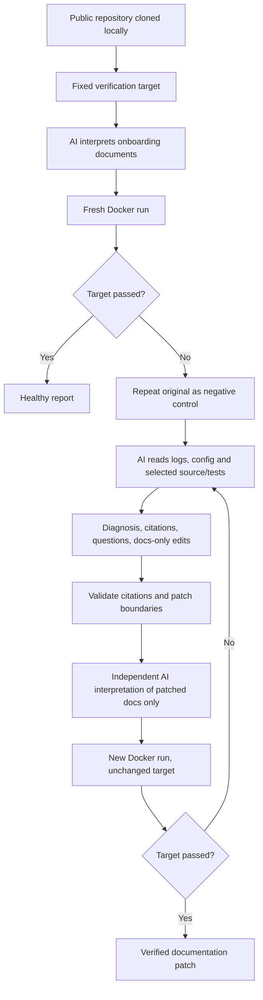

# Architecture and AI boundaries

## Components

| File | Responsibility |
|---|---|
| `app.py` | Loopback HTTP server, request validation, one-job queue, public GitHub cloning, artifact delivery |
| `web/index.html` | Responsive buildless HTML/CSS/JavaScript form, progress polling, embedded reports |
| `assistant.py` | Model-led document interpretation, failure reasoning, constrained docs edits, bounded repair loop |
| `ghostmaintainer.py` | CLI, legacy extractor/search, Docker runner, fixed-goal verification, patches and reports |
| `features.py` | Drift, timings, matrix, setup artifacts, benchmarking, scan and guard helpers |
| `test_*.py` | Regression and boundary tests; model validation tests use mocked answers |

No web framework, database, hosted inference, or paid API is used. The application is a source-checkout prototype. The Python module install metadata does not package all web/fixture/benchmark assets; use the cloned source directory for the full experience.

## AI assistant pipeline

The loop is capped at three repair attempts. The model cannot mark its own execution successful. Docker exit codes and a positive test count or fixed output marker decide verification. The negative control compares command/exit-code fingerprints; it is not a formal causal proof.

Initial and verification interpretations see onboarding documents rather than configuration recovery context. Diagnosis sees a bounded selection of configuration, source and test files. README/CONTRIBUTING prose and inline instructions are interpreted by the model; the old `drill` mode still extracts shell fences and selects candidate commands from configuration.

Model commands may be synthesized from evidence. Initial unsupported exploratory actions are filtered, and selected commands/citations are validated. Diagnosis is not guaranteed correct: limited context previously caused a real src-layout installation problem to be misidentified as missing code.

## Repair constraints

Schema-constrained repair JSON limits edit paths to existing onboarding documents. Old text must match uniquely; a fallback tolerates indentation-only differences in multiline blocks. Application/configuration/test files cannot be changed through this patch mechanism. Citation ranges must be within supplied source lines. Exact duplicate `> Note:` paragraphs are removed; this is not general patch-quality assurance.

A rejected or failed proposal is not published as a verified fix. Temporary copies hold proposed edits. Model output, prompts, confidence, cache use, and rejected actions are not independent evidence of correctness. The system remains intended for inspected inputs; see SECURITY.md for execution limits.

## Docker execution

Default image: `python:3.12-slim`. Each run gets a read-only input copy and writable disposable workspace. The container uses a non-root user, dropped capabilities, no-new-privileges, network disabled by default, 512 MiB memory, one CPU, PID limit, workspace size limit, and a 90-second run timeout. Shell state persists within a run; environments are fresh between runs. A writable disposable HOME supports user-level installations.

Host environment variables/credentials are not intentionally forwarded into containers. Repository files can still contain sensitive content; inspect inputs. `--net` permits outbound container networking. Docker itself, its daemon, and image downloads are outside the no-network container policy.

There is no arbitrary host execution fallback. A separate hash-checked fixture backend accepts only bundled fixture commands and is not a sandbox for other repositories.

## Other modes

- **Drift:** literal Python/Node variable reads and version evidence, with basic inequalities; advisory only.
- **Matrix:** Python images, maximum three concurrent cells; version notes cite CI and are checked on its pinned image. Unsupported runtimes remain failed.
- **Ship:** emits passing commands into bash setup.sh and tests the script separately. Other artifacts remain unverified.
- **Benchmark:** fixed hand labels, pinned upstream selection input, fixture mutation/healthy checks; cache policy and sample sizes disclosed.
- **Scan:** public clones, permissive-license heuristic, setup denylist, per-repo total timeout and labelled-container cleanup; outputs anonymous local aggregates.
- **PR Guard:** rules-only GitHub Action on the controlled fixture; analysis token is read-only and same-repository comment permissions are isolated in another job.

## Storage and hosting

`runs/` holds clones/reports; `.cache/` holds JSON model answers. Both are ignored by Git. Web jobs are indexed in memory. There is no database, login system, multi-user scheduler, production deployment, billing, or cloud sandbox. Binding defaults to `127.0.0.1:8765`.
